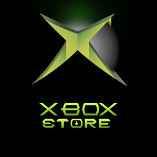
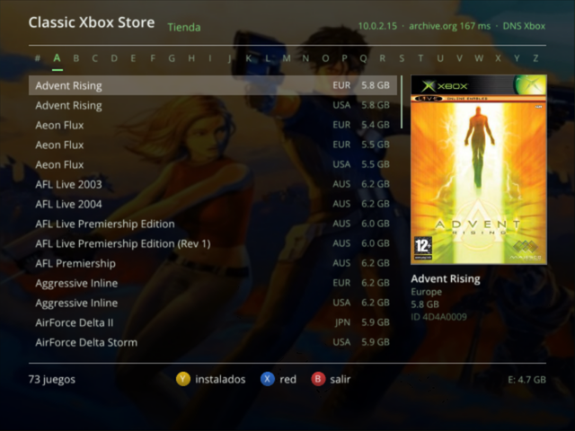
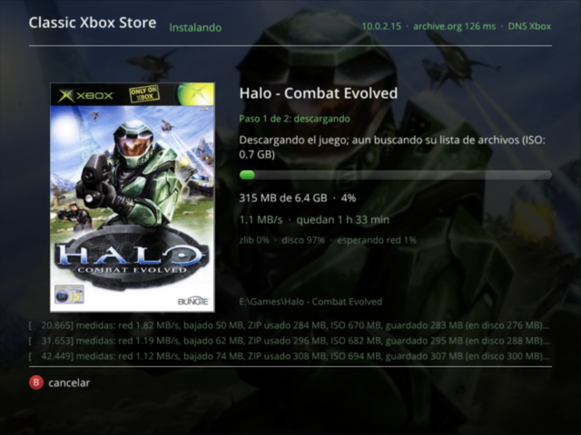
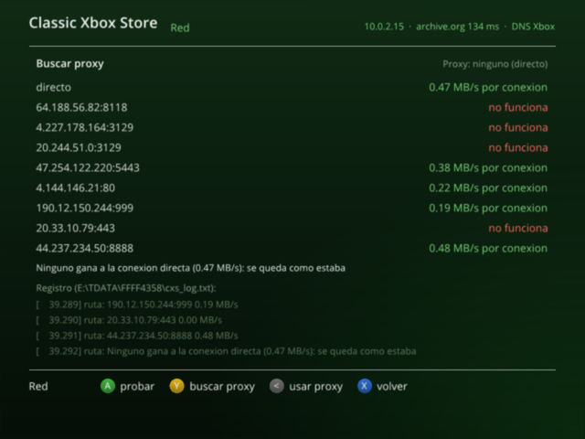
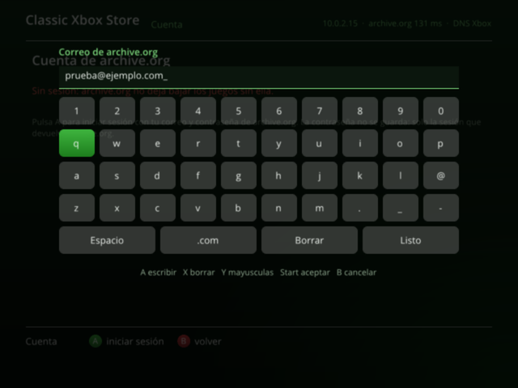

# Classic Xbox Store

<p align="center"></p>

Tienda de juegos **nativa para la Xbox original** (2001): un `default.xbe` que se abre desde el panel de una consola modificada, muestra el catálogo de juegos de Xbox de Internet Archive con sus portadas, los **descarga e instala directamente en el disco duro de la consola** y los abre desde su propia lista. Sin PC de por medio.

Es la versión para consola de [Classic Xbox Loader](https://github.com/xeodeo) (la aplicación de PC que descarga, extrae y sube los juegos por FTP), hecha con el mismo sistema de compilación que el port de [OptiCraft a la Xbox](https://github.com/xeodeo/OptiCraft-Heritage-XBOX-CLASSIC-Edition).

| Tienda | Descarga |
|---|---|
|  |  |
| **Red y proxies** | **Cuenta (teclado en pantalla)** |
|  |  |

## Qué hace

- **Tienda:** catálogo de Internet Archive por letras (`#`, `A`…`Z`), con región y tamaño. El juego elegido pone su **portada** a la derecha y su **fondo** detrás, con un fundido. Las listas y las imágenes se guardan en `T:\cache`, así que la segunda vez salen al instante y se siguen viendo aunque archive.org esté caído.
- **Instalar (A):** elige la unidad (`E:`, `F:` o `G:`, con el espacio libre real) y:
  1. baja el **ZIP** de archive.org con **16 conexiones a la vez** (cada trozo con `Range`) y lo descomprime en la consola con zlib;
  2. se salta la partición de vídeo de la imagen redump (los primeros 387 MB) y guarda la del juego en trozos de menos de 4 GB (límite de FATX);
  3. en cuanto llega el árbol de archivos del disco (XDVDFS) sabe dónde acaba el último archivo y **corta la descarga ahí**: el relleno del final no se baja;
  4. copia los archivos a `<unidad>:\Games\<juego>` (el `default.xbe` el último), comprueba que cada uno mida lo que dice el disco original y borra los temporales.
- **Seguir lo que quedó a medias:** cada 128 MB se guarda un punto de control (el estado de zlib incluido, como el ejemplo `zran` de zlib). Si se apaga la consola, se sale con la combinación de botones o se cae la red, al abrir la tienda pregunta si se quiere seguir. Lo mismo si se corta mientras copia.
- **Instalados (Y):** los juegos y aplicaciones del disco duro (cualquier carpeta de primer nivel con subcarpetas que tengan `default.xbe`), separados en *Juegos* y *Aplicaciones*. **A los abre.**
- **Cuenta (Start):** iniciar sesión en archive.org desde la consola con un teclado en pantalla (archive.org no deja bajar estas colecciones sin sesión). La contraseña no se guarda: solo las cookies que devuelve archive.org, en `T:\ia_session.json`. También vale el `ia_session.json` de Classic Xbox Loader copiado junto al `default.xbe`.
- **Red (X):** diagnóstico (IP, DNS, conexiones, HTTPS) y las últimas líneas del registro. **Y abre Proxies:** buscar proxies gratis cercanos (A) y activarlos o quitarlos (Y). Vienen **apagados por defecto**; si se activan, la mitad de las conexiones va por ellos, la lista se renueva sola cada 3 horas y una conexión cuyo proxy falla sigue directa.
- **Idiomas:** inglés (por defecto), español y portugués. Se cambian en Cuenta (Start) con Y y la elección se guarda.

## Cómo funciona por dentro

- **HTTPS en la Xbox:** [mbedTLS](https://github.com/Mbed-TLS/mbedtls) 3.6 (solo cliente TLS 1.2, sin instrucciones que el Pentium III no tenga) sobre los sockets de XNet. Los certificados raíz necesarios van dentro del XBE (`assets/certs/roots.pem`).
- **Velocidad:** la pila TCP de la Xbox no amplía la ventana (64 KB como mucho por conexión); con ~0,2 s de ida y vuelta hasta archive.org eso son ~0,3 MB/s por conexión. Por eso se reparten trozos de 1 MB entre 16 conexiones que se reutilizan (keep-alive); en una consola real da 3–5 MB/s.
- **DNS:** si el DNS que configura el panel no responde, se pregunta a 1.1.1.1 y 8.8.8.8, y se recuerdan las direcciones.
- **Portadas:** el índice `assets/data/artindex.tsv` (creado con `scripts/make_art_index.py`) relaciona el nombre redump de cada ZIP con su XMID y Title ID y dice qué arte existe, para no pedir imágenes que no hay.
- **Registro:** `E:\TDATA\FFFF4358\cxs_log.txt` (se saca por FTP desde el panel). Si un hilo falla, anota la excepción, los registros y la pila con direcciones del `.map`.

## De dónde salen los juegos

Del catálogo de juegos de Xbox de Internet Archive, las mismas colecciones que usa Classic Xbox Loader:

- `https://archive.org/details/microsoft_xbox_numberssymbols` (#)
- `https://archive.org/details/microsoft_xbox_a` … `microsoft_xbox_z` (algunas letras en dos partes: `microsoft_xbox_c_part1` y `_part2`, igual con D, M, N, O, S y T)

La lista de cada letra sale de `https://archive.org/metadata/<colección>/files` y cada juego se baja de `https://archive.org/download/<colección>/<juego>.zip`. Hace falta una cuenta de archive.org.

Este repositorio no aloja ni distribuye ningún juego.

## Compilar

### Lo que hace falta

- **Windows 10/11** con **Visual Studio 2022** (carga de trabajo *Desarrollo para el escritorio con C++*, con las herramientas x86) y el **Windows 10/11 SDK** (para el UCRT estático).
- **Python 3** (mete las fuentes, los certificados y el índice de portadas dentro del XBE).
- **El XDK de Xbox (5849).** **No está en este repositorio y no se debe subir nunca.** Es el mismo que usa OptiCraft: se conserva en la colección de Internet Archive <https://archive.org/details/xbox-sdks> (archivo `2005-03 - 5849.6, 5849.17 - RecoveryEXE, SDK.7z`).
  1. Descarga ese archivo y descomprímelo con 7-Zip: dentro está `XDKSetup5849.17.exe`.
  2. Descomprime también el instalador con 7-Zip (no hace falta instalarlo; pide Visual Studio .NET 2003 y Windows XP):

     ```text
     7z x XDKSetup5849.17.exe -o<xdk>\sdk
     ```

  3. El XDK queda en `<xdk>\sdk\XDK\xbox` (`bin\`, `include\`, `lib\`). Esa carpeta es la que se usa: el enlazador del XDK (`bin\vc71\Link.Exe`), `imagebld.exe`, `bundler.exe` y las bibliotecas de XAPI, Direct3D 8 y XNet.
- `scripts/ninja.exe` y `scripts/extract-xiso.exe` ya vienen en el repositorio.

Probado con Windows 10 Pro 22H2, Visual Studio 2022 Community (MSVC 14.44), Windows SDK 10.0.26100, CMake 3.31 (el de Visual Studio), Ninja 1.13.2, XDK 5849, extract-xiso 2.7.1, [xemu](https://xemu.app) y una consola retail con softmod.

### Comandos

En PowerShell:

```powershell
$env:XBOX_XDK_ROOT = "C:\ruta\al\xdk\5849\sdk\XDK\xbox"
$cmake = "C:\Program Files\Microsoft Visual Studio\2022\Community\Common7\IDE\CommonExtensions\Microsoft\CMake\CMake\bin\cmake.exe"
& $cmake --preset xbox
& $cmake --build --preset xbox
```

Sale en `bin/`:

- `bin/iso/` con `default.xbe` y `default.tbn` (la miniatura para paneles tipo XBMC/UnleashX). **Esa carpeta es la que se copia a la consola**, por ejemplo a `F:\Apps\Classic Xbox Store\`.
- `bin/ClassicXboxStore.iso`, lo mismo como ISO para xemu.

El preset `xbox-autotest` compila una versión de prueba para xemu (en `bin-autotest/`) que instala sola un ZIP servido desde el PC (`10.0.2.2:8000`, un servidor HTTP con `Range`), sin depender de archive.org.

### Cómo se compila (el mismo truco que OptiCraft)

El compilador del XDK es Visual C++ 7.1 (2003), que no entiende C++17. Así que se combinan dos:

- **Compilar:** el `cl.exe` de VS2022 (x86, `/arch:SSE`: el Pentium III tiene SSE pero no SSE2) contra la STL y el UCRT modernos (`cmake/xbox_toolchain.cmake`).
- **Enlazar:** el `Link.Exe` del XDK, con el CRT estático moderno (`libcmt`, `libcpmt`, `libucrt`) y luego las bibliotecas del XDK. `src/runtime/XboxCrtShim.cpp` pone las funciones de Win32 que el CRT moderno necesita y XAPI no tiene, y `src/runtime/XboxEntry.cpp` repite el arranque del XDK.
- **Después:** `scripts/patch_pe_for_imagebld.ps1` prepara el PE para `imagebld`, `scripts/patch_sse2_moves.ps1` cambia las instrucciones SSE2 que deja el CRT por equivalentes que el Pentium III sí tiene, `bundler.exe` empaqueta el icono e `imagebld.exe` crea el `default.xbe`.

### Datos que van dentro del XBE

| Archivo | Qué es | Cómo se regenera |
|---|---|---|
| `assets/fonts/OpenSans-*.ttf` | Letra de la interfaz | — |
| `assets/certs/roots.pem` | Certificados raíz (Let's Encrypt/ISRG, GoDaddy, DigiCert, USERTrust, GlobalSign) | de `certifi` |
| `assets/data/artindex.tsv` | Índice de portadas (nombre redump → XMID, Title ID y arte disponible) | `python scripts/make_art_index.py` |
| `assets/icon/` | Icono del panel, de las partidas guardadas y `default.tbn` | `python scripts/make_icon.py` |
| `src/ui/LangTable.inc` | Traducciones (inglés y portugués) de los textos, que en el código están en español | `python scripts/make_lang.py` (desde `scripts/translations.py`) |

## Usar en la consola

1. Copia el contenido de `bin/iso/` a una carpeta del disco duro (por FTP desde el panel), por ejemplo `F:\Apps\Classic Xbox Store\`.
2. Ábrela desde el panel.
3. Inicia sesión con **Start** (o copia el `ia_session.json` de Classic Xbox Loader junto al `default.xbe`).

| Botón | Tienda | Instalados | Red |
|---|---|---|---|
| A | instalar | abrir | probar la red (en Proxies: buscar) |
| Y | ir a Instalados | ir a la Tienda | abrir Proxies (en Proxies: activar / quitar) |
| X | Red | Red | volver |
| Start | Cuenta (Y: idioma) | Cuenta | Cuenta |
| Izquierda / derecha | letra | — | — |
| Gatillos | página | página | — |
| B | volver al panel | volver al panel | volver al panel |

## Créditos

- **Portadas, fondos e iconos de los juegos:** base de datos y arte de **MobCat** — <https://mobcat.zip/XboxIDs/> y <https://github.com/MobCat/MobCats-original-xbox-game-list>. La tienda los baja de ese repositorio; no se incluyen aquí.
- **Juegos:** colecciones de Xbox de [Internet Archive](https://archive.org).
- **Lista de proxies:** [ProxyScrape](https://proxyscrape.com).
- [mbedTLS](https://github.com/Mbed-TLS/mbedtls) (Apache 2.0), [zlib](https://zlib.net) (licencia zlib), [stb_image y stb_truetype](https://github.com/nothings/stb) (dominio público / MIT), [Open Sans](https://fonts.google.com/specimen/Open+Sans) (Apache 2.0), [extract-xiso](https://github.com/XboxDev/extract-xiso) y [Ninja](https://ninja-build.org).
- Sistema de compilación y arranque tomados del port de OptiCraft a la Xbox, de xeodeo.
- Estilo de la interfaz inspirado en [PKGi](https://github.com/bucanero/pkgi-ps3).

Xbox es una marca de Microsoft. Este proyecto no tiene relación con Microsoft ni con Internet Archive.
